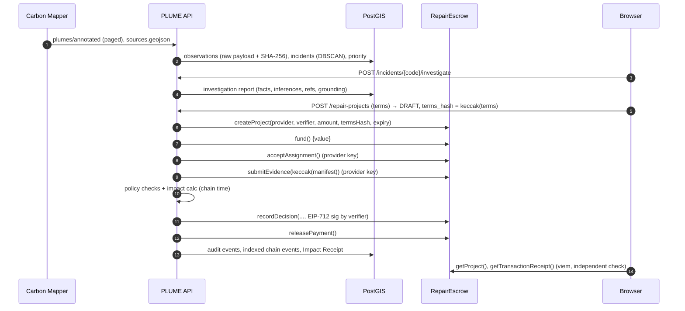

# PLUME architecture

PLUME is a modular monolith: one FastAPI service, one PostgreSQL/PostGIS database, one Solidity contract and one Next.js client. There are no queues or microservices. Ingestion is a CLI job; everything else is a request/response flow.

## Components

| Component | Path | Responsibility |
|---|---|---|
| Provider adapters | `backend/app/providers/` | `CarbonMapperAdapter` (live API: pagination, retry/backoff, `Retry-After`, timeouts, on-disk cache), `SnapshotAdapter` (versioned offline data), a shared `NormalizedObservation` record |
| Ingestion pipeline | `backend/app/ingestion/pipeline.py` | normalise → reject with reasons → de-duplicate (provider id and re-issued detection) → bulk insert (`ON CONFLICT DO NOTHING`) → group into incidents → score |
| Investigation engine | `backend/app/investigation/` | `clustering.py` (DBSCAN haversine), `scoring.py` (explainable priority), `knowledge.py` (curated KB + TF‑IDF), `report.py` (Pydantic schema + grounding checks), `llm.py` (Claude adapter), `engine.py` (orchestration + template narrative) |
| Repair workflow | `backend/app/repair/` | `state_machine.py` (lifecycle and roles), `service.py` (locking, chain calls, audit, reconciliation, receipts), `evidence.py` (bundle storage and commitment), `policy.py` (verification checks) |
| Impact accounting | `backend/app/impact/calculator.py` | reduction × documented duration × cited GWP, with uncertainty bounds and explicit refusal reasons |
| Chain client | `backend/app/chain/client.py` | web3.py transactions per persona key, log decoding, EIP‑712 typed-data signing cross-checked against the contract's own digest, revert-reason decoding |
| API | `backend/app/api/` | versioned REST under `/api/v1`, OpenAPI at `/docs` |
| Contract | `contracts/src/RepairEscrow.sol` | escrow, roles, EIP‑712 decisions, disputes, expiry, pull-payment fallback |
| Web app | `frontend/src/` | Mission Control map, incident/investigation/project/verification/ledger/receipt screens; independent chain reads with viem |

## Data flow



Every state-changing action does the following, in order:
1. Lock the project row with `SELECT … FOR UPDATE`.
2. Check the lifecycle transition and the actor's role and participation.
3. Send the contract transaction and wait for the receipt.
4. Update the row, which carries an optimistic version column.
5. Write an `AuditEvent` with the transaction hash.
6. Upsert the decoded contract events into `chain_events`, keyed by (chain, tx, log index).

## Database entities

`users` (persona, role, wallet, HD index) · `ingestion_runs` (source, SHA‑256, stats) · `observations` (PostGIS point plus raster footprint polygon, rate, uncertainty, instrument, sector, flags, raw JSON, raw SHA‑256; unique on provider and external id; CHECKs that gas is CH₄, rate > 0 and coordinates are valid) · `incidents` (centroid, counts, spread, priority and breakdown JSON, grouping method and parameters, provider source context) · `incident_observations` (each observation belongs to exactly one incident) · `investigations` (report JSON, kind, model id, inputs digest, latency) · `repair_projects` (terms JSON and hash, evidence policy, amount in wei as `NUMERIC(78)`, status CHECK, independence CHECK, on-chain id unique per chain and contract, funding block time, version) · `evidence` (round, keccak commitment, manifest, storage path, tx; unique per project and round) · `verifications` (outcome CHECK, policy checks, impact, EIP‑712 digest, signature, tx; unique per project and round) · `audit_events` · `chain_events` (unique per chain, tx and log index) · `impact_receipts` (payload and SHA‑256, settlement tx).

Migrations: `backend/alembic/versions/0001`, `0002`. Indexes: GiST on geometries; B-tree on priority, time, sector, instrument and source name.

## Lifecycle

```
DRAFT ─publish→ OPEN_FOR_FUNDING ─fund→ FUNDED ─accept→ ASSIGNED ─submit→ REPAIR_SUBMITTED ─review→ UNDER_VERIFICATION
   └cancel→ CANCELLED   └cancel→ CANCELLED (refund)                         │
                                                                             decide (EIP-712)
     ┌──────────────────────────────┬──────────────────────┬───────────────┴──────────────┐
  VERIFIED ─release→ PAID       REJECTED            INCONCLUSIVE        ADDITIONAL_EVIDENCE_REQUIRED
     │ (within dispute window)       └──── submit (new round) ◄─────────────┴──────────────────┘
     └dispute→ DISPUTED ─decide (fresh round)→ …        any unverified state after expiry ─refund→ EXPIRED
```

`DRAFT` and `UNDER_VERIFICATION` exist only off-chain. Every other state mirrors a contract state, and the contract is authoritative (`CHAIN_TO_STATUS` in `chain/client.py`). Impossible transitions are rejected twice: by `state_machine.check_transition` (HTTP 403/409) and again by the contract (custom errors, surfaced as `contract reverted: <Error>`).

## Trust boundaries

| Boundary | Trusted for | Not trusted for | Enforcement |
|---|---|---|---|
| Carbon Mapper | the detection record as published | facility identity, component, persistence | raw payload stored with digest; flags shown; persistence only from provider counts |
| PLUME backend | orchestration, policy evaluation, storage of evidence files | moving funds, forging decisions | contract checks roles and signatures independently; evidence commitment checked against stored files |
| Verifier | judging whether the repair is evidenced | anything else | one designated key per project; EIP‑712 bound to chain, contract, project, round, evidence hash and report hash; admin can revoke |
| Administrator | approving participants | escrowed funds, decisions | no withdrawal path in the contract (tested) |
| Blockchain | integrity of commitments and enforcement of payment rules | whether methane went down | stated in UI, receipt and docs |

## Verification assumptions

- Verifiers are approved, independent of sponsor and provider (different wallet and organisation, enforced in both backend and contract), and accountable for their signature.
- Evidence files are stored off-chain. The chain holds only the manifest hash, and verification recomputes every file digest from storage.
- Policy checks run server-side against **chain time**. VERIFIED is refused (HTTP 409) while any required check fails. The verifier may still record REJECTED, INCONCLUSIVE or ADDITIONAL_EVIDENCE_REQUIRED.

## Fault tolerance

- **Provider outage:** snapshot mode is the default. Live ingestion retries, caches and fails loudly. A missing plume image returns 502 and the UI degrades.
- **LLM outage, refusal or ungrounded output:** deterministic template narrative, with the reason recorded.
- **Chain/DB divergence** (for example a crash after a mined transaction): `POST /repair-projects/{id}/reconcile` re-indexes contract logs idempotently and resets the DB status to the chain state. Tested in `test_reconcile_repairs_db_drift`.
- **Duplicate or concurrent requests:** row locks plus lifecycle checks, plus the contract's own state checks (double funding and double settlement are tested at every layer).
- **Push payment failure:** the contract credits `pendingWithdrawals`, so funds are never stuck (tested with a reverting receiver).

## Data provenance

Each observation keeps its provider, external id, display id, source URL, the full raw payload without expiring signed URLs, the payload's SHA‑256 and its ingestion run. The run records the snapshot file's SHA‑256 and the request parameters. Reports cite observation ids; receipts embed source URLs, terms hash, evidence hash, decision digest and transaction hashes.

## Model limitations

The priority score is a ranking heuristic with hand-set weights; it has not been validated against field outcomes. DBSCAN uses ε = 200 m. That value best matches Carbon Mapper's grouping (ARI sweep in EVALUATION.md) but was not validated against ground truth. TF‑IDF retrieval over 13 entries is a simple ranker, not semantic search. LLM narratives are constrained and checked, but the checks are heuristic: numbers within ±1%, a fixed organisation-suffix pattern and id membership.

## Deployment

**Local** (tested): `make bootstrap && make dev`.

**GitHub Pages, read-only static snapshot** (deployed at https://kaavinb.github.io/PLUME/):
1. With the local stack running, `scripts/export_static_snapshot.py` saves verbatim GET responses. It also records the receipt's contract reads (`getProject` and the settlement receipt) from Anvil, since a static site cannot reach that chain.
2. `scripts/build_pages.sh` builds the frontend with `NEXT_PUBLIC_STATIC_SNAPSHOT=1`: `output: "export"`, base path `/PLUME`, and every incident, investigation, project and receipt page pre-rendered.
3. The result is `site/`, which is published to the `gh-pages` branch.

In this mode `lib/snapshot.ts` serves reads from the exported files, refuses every write with an explanation, and hides persona switching and action buttons. A banner states what the site is. `demo-video/scripts/check-pages.mjs` smoke-tests the result.

**Base Sepolia** (not executed here: no funded key was available). With a funded key in a Foundry keystore:
```bash
cd contracts
APPROVE_PROVIDERS=0x… APPROVE_VERIFIERS=0x… DEPLOYMENT_NAME=base-sepolia \
  forge script script/Deploy.s.sol:Deploy --rpc-url https://sepolia.base.org --account deployer --broadcast
forge inspect RepairEscrow abi --json > deployments/RepairEscrow.abi.json
# backend .env
PLUME_CHAIN_RPC_URL=https://sepolia.base.org  PLUME_CHAIN_ID=84532  PLUME_CHAIN_NAME="Base Sepolia"
PLUME_CHAIN_EXPLORER_URL=https://sepolia.basescan.org  PLUME_DEPLOYMENT_FILE=contracts/deployments/base-sepolia.json
PLUME_DEMO_MNEMONIC="<a testnet-only mnemonic whose indexes 0–3 hold Base Sepolia ETH>"
```
Simulated time and demo reset refuse to run on any chain other than 31337, so they are disabled on Base Sepolia automatically. Demo personas still work on the testnet, but their keys must come from a dedicated, testnet-only mnemonic. Setting `PLUME_DEMO_MODE=false` disables persona login altogether; the intended production replacement, wallet login, is not implemented yet.
The UI then links every transaction hash to the explorer. **Hosting:** the frontend runs on Vercel (`NEXT_PUBLIC_API_URL`, `NEXT_PUBLIC_CHAIN_RPC_URL`). The API runs as a container on Cloud Run, Render or Railway with a managed PostGIS database: run `alembic upgrade head`, then `python -m app.cli ingest-snapshot`. None of this has been deployed.
