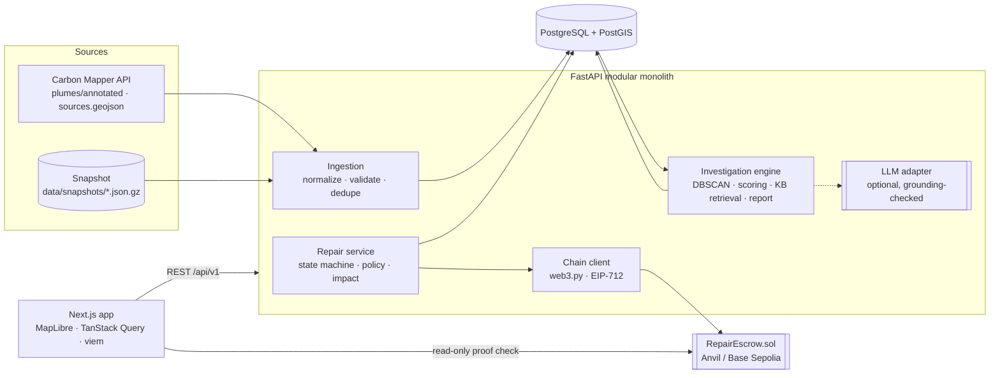

# PLUME

**The planet has bugs. Let's fix them.**

PLUME turns documented methane plume detections into investigated, funded and independently verified repair projects. Payment is released by a smart contract only on a verifier's signed decision, and every step leaves a public receipt you can inspect.

> **What is real and what is simulated**
> - **Real:** 10,098 historical CH₄ plume detections over the Permian Basin (TX/NM), retrieved from the [Carbon Mapper](https://carbonmapper.org) public API on 2026‑10‑12 and stored as a version-controlled snapshot.
> - **Executed:** ingestion, grouping, prioritisation, investigation reports, verification policy checks, impact maths, EIP‑712 signing and every escrow transaction all run for real on a local Anvil chain (or a public testnet).
> - **Simulated:** the repair work, repair documents, site measurements, the participating organisations and the funds. Simulated items are labelled wherever they appear and are never mixed into real-data totals.
>
> PLUME is a hackathon prototype. It has **not** coordinated any real-world repair and makes no claim of achieved emission reductions.

**See it without installing anything:**
- **[Read-only snapshot of the app](https://kaavinb.github.io/PLUME/)** on GitHub Pages: the real UI, served from data exported from a local run of the full stack. No backend runs there, so actions are disabled.
- **[4.5-minute narrated demo video](https://kaavinb.github.io/PLUME/demo/plume-demo-final.mp4)**: the full workflow recorded live against the local stack.

Built for the **IEEE ClimateChain Global Hackathon 2026**: *Carbon Markets & Emissions Transparency* (primary), *Climate Data & Environmental Monitoring* (secondary).

---

## The problem

Satellites and aircraft already find large methane leaks. Carbon Mapper publishes plume detections, and UNEP's Methane Alert and Response System (MARS) notifies governments and operators. Detection does not by itself get a leak fixed. In between sit questions with no shared, inspectable answer:

> **Who is fixing this problem, who is funding it, how do we know the outcome, and where is the evidence?**

PLUME does **not** claim to be the first to detect methane from space. It adds an open, programmable **repair-funding and verification workflow** on top of existing observation systems.

## What PLUME does

| Stage | What happens | Where |
|---|---|---|
| **Detection** | Real Carbon Mapper plumes on an interactive map, with filters, clustering, provenance and the provider's own plume raster | Mission Control `/` |
| **Investigation** | Validation → DBSCAN grouping → explainable priority score → retrieval of source-linked guidance → structured report with a grounding check | `/incidents/[code]`, `/investigations/[id]` |
| **Funding** | A sponsor defines authorised scope, milestones and the evidence policy, then escrows test funds against a keccak‑256 hash of the terms | `/projects/new`, `/projects/[code]` |
| **Repair** | The approved provider accepts on-chain and commits an evidence bundle (keccak‑256 of a canonical manifest of SHA‑256-hashed files) | `/projects/[code]` |
| **Verification** | An independent verifier reviews the evidence against server-side policy checks and signs an **EIP‑712** decision bound to the exact evidence hash and review round | `/verification/[code]` |
| **Proof** | The escrow releases only on a VERIFIED signature. An Impact Receipt links every step from satellite detection to settlement transaction, and the browser re-reads the contract directly (viem) | `/receipts/[id]` |

The design follows one principle: **no subsystem claims more certainty than the whole system can support.**
- Observation establishes evidence of a potential problem.
- Investigation supports decisions about what to do.
- Escrow establishes a financial commitment.
- Independent verification authorises settlement.
- The blockchain keeps an auditable record of the commitment and the outcome.

## Architecture



See [ARCHITECTURE.md](ARCHITECTURE.md) for data flow, entities, trust boundaries and fault tolerance.

## How AI is used (and how it isn't)

The investigation is mostly **deterministic computation**. A language model is an optional narrative layer on top:

1. **Validation:** coordinates, timestamps, gas, units, uncertainty bounds, duplicate detections, raw-payload digests.
2. **Geospatial grouping:** DBSCAN (haversine, ε = 200 m, per provider sector), compared with Carbon Mapper's own grouping. Agreement: adjusted Rand index **0.974** over all 10,098 detections.
3. **Explainable prioritisation:** seven weighted factors (magnitude, recurrence, provider persistence, independent instruments, recency, measurement confidence, localisation). Each factor's evidence is shown. The score ranks where to investigate first; it is not an impact estimate.
4. **Retrieval:** TF‑IDF ranking over a curated, source-linked knowledge base of 13 guidance entries (US EPA, IEA, UNEP/OGMP, eCFR), filtered by sector.
5. **Report:** a validated Pydantic schema (`InvestigationReport`) that separates confirmed facts (each citing evidence ids) from inferences (each with a confidence and basis refs), plus limitations and unresolved questions.
6. **Optional LLM narrative:** with `PLUME_LLM_PROVIDER=anthropic`, Claude writes only the narrative fields, using structured output. A **grounding check** rejects the narrative if it cites unknown evidence ids, introduces numbers that are not in the evidence pack, or names organisations. On rejection, refusal or outage, PLUME falls back to a deterministic template **and says so** in the report.

No API key was available while building, so every report in the demo is labelled *"Deterministic template narrative — no language model was used"*. The LLM path is implemented and unit-tested with fakes. It has not been exercised against a live model.

## Why blockchain is needed

A sponsor, a contractor and a verifier who don't trust each other need a commitment that none of them can quietly change. `RepairEscrow.sol` enforces:

- funds can only go to the named provider, and only after the named verifier signs **VERIFIED** for the current evidence hash and round;
- rejected, inconclusive or disputed decisions can never pay out, and settlement cannot happen twice;
- signatures are bound to chain, contract, project, round and evidence hash, so they cannot be replayed;
- the administrator can approve participants but **has no path to escrowed funds**;
- after expiry, unverified escrow returns to the sponsor.

**The chain cannot observe methane.** Whether a repair worked is the verifier's judgement. The contract makes that judgement attributable, tamper-evident and binding on the money. See [SECURITY.md](SECURITY.md).

## Tech stack

| Layer | Choice |
|---|---|
| Backend | Python 3.12, FastAPI, Pydantic v2, SQLAlchemy 2, GeoAlchemy2, Alembic, scikit-learn, web3.py 8, eth-account, Anthropic SDK (optional) |
| Data | PostgreSQL 16 + PostGIS 3.4 (Docker) |
| Contracts | Solidity 0.8.26, Foundry, OpenZeppelin 5.1 (EIP712, ECDSA, ReentrancyGuard, Ownable2Step) |
| Frontend | Next.js 16, React 19, TypeScript (strict), Tailwind CSS 4, MapLibre GL 5, TanStack Query 5, viem 2, Motion |
| Tests | pytest (+ throwaway Anvil), Foundry unit/fuzz/invariant tests, Playwright |

## Data sources

| Source | Use | Access |
|---|---|---|
| [Carbon Mapper Data Platform API](https://api.carbonmapper.org/api/v1/docs): `GET /catalog/plumes/annotated`, `GET /catalog/sources.geojson`, `GET /catalog/plume/{id}` | CH₄ plume detections, provider source grouping, plume raster images | Public, no token needed. Endpoints verified against the live OpenAPI spec. |
| `data/snapshots/carbonmapper_permian_ch4.json.gz` | Offline mode: 10,098 plumes plus 3,827 provider sources, bbox −104.5, 31.0, −101.0, 33.5 | Retrieved 2026‑10‑12; signed URLs stripped; SHA‑256 recorded at ingestion |
| `data/snapshots/plume-images/` | Plume PNGs for the 3 featured incidents (55 images) | Carbon Mapper data products, cached for offline demo |
| IPCC AR6 WG1 Ch. 7 Table 7.15 | GWP‑100: 29.8 (fossil CH₄), 27.0 (non-fossil) | Cited in every impact calculation |
| NASA EMIT L2B CH4PLM | **Not integrated as a separate adapter.** Carbon Mapper's catalogue already includes 253 EMIT detections in this region, labelled by instrument. | — |

Carbon Mapper requires attribution, which PLUME shows on the map, in every observation record and on the ledger.

## Run it locally

Prerequisites: Docker, [uv](https://docs.astral.sh/uv/), Node 20+, and [Foundry](https://getfoundry.sh) (`curl -L https://foundry.paradigm.xyz | bash && foundryup`). Without Foundry on the host, the deploy script falls back to the Foundry Docker image.

```bash
git clone <repo> plume && cd plume
cp .env.example .env
make setup        # uv sync, npm ci, forge deps
make bootstrap    # PostGIS + Anvil, migrations, ingest real snapshot, deploy RepairEscrow, seed personas
make dev          # API on :8000 and web app on :3000
```

Open http://localhost:3000. The OpenAPI docs are at http://localhost:8000/docs.

Without `make`, the same steps are:
```bash
docker compose up -d --wait db && anvil --port 8545 &           # or: docker compose up -d anvil
cd backend && uv sync && uv run alembic upgrade head && uv run python -m app.cli ingest-snapshot && cd ..
./scripts/deploy-local.sh
cd backend && uv run python -m app.cli seed-demo && uv run uvicorn app.main:app --port 8000 &
cd ../frontend && npm ci && cp .env.example .env.local && npm run dev
```

Live data instead of the snapshot: `cd backend && uv run python -m app.cli ingest-live --bbox=-104.5,31,-101,33.5`. It paginates, retries on 429/5xx with backoff, honours `Retry-After`, caches responses and de-duplicates by provider id and detection.

## Guided demo

Click **Guided demo** in the top bar for a 12-step checklist that tracks your progress. Use **Acting as** to switch persona. Every persona belongs to a fictional organisation and signs with a key derived from the public Anvil test mnemonic.

| Persona | Can |
|---|---|
| Sponsor | investigate, create and fund repair projects, cancel, dispute, reclaim expired escrow |
| Provider | accept assignments, submit evidence, dispute, trigger settlement |
| Verifier | review evidence, sign VERIFIED / REJECTED / INCONCLUSIVE / ADDITIONAL_EVIDENCE_REQUIRED |
| Observer | read everything, change nothing |
| Admin | approve participants on-chain, reset local demo state; **cannot move escrow** |
| Contractor (unapproved) | demonstrates that the contract rejects unapproved providers |

The simulated repair needs 28 days of post-repair monitoring. On the local chain only, **Fast-forward** advances Anvil's block time so funding time, repair timestamps, measurements and contract expiry stay consistent.

`make demo-reset` clears projects and investigations, redeploys a fresh escrow and re-seeds personas. It refuses to run unless `PLUME_DEMO_MODE=true` and chain id 31337. Full walkthrough: [DEMO_SCRIPT.md](DEMO_SCRIPT.md).

## Testing

```bash
make test-contracts   # 39 unit/fuzz tests + 2 invariants (Foundry)
make test-backend     # 83 pytest tests: unit, PostGIS integration, full on-chain workflow on a throwaway Anvil
make test-e2e         # Playwright: the full UI journey + the policy-blocked rejection path (needs `make dev`)
uv run --project backend python scripts/e2e_api.py   # 41-check API journey incl. negative authorisation paths
make lint typecheck   # ruff, mypy, eslint, tsc, forge fmt
```

To run Playwright with an installed Google Chrome instead of downloading Chromium, use `PLAYWRIGHT_CHANNEL=chrome`. Measured results are in [EVALUATION.md](EVALUATION.md).

## Scientific limitations (short version)

- Provider emission estimates are **instantaneous snapshots** at overpass time. PLUME never multiplies them by an assumed duration.
- Plume origins locate a source to tens to hundreds of metres. They do **not** identify an operator, a facility or a component.
- Grouping nearby detections is a hypothesis about a shared source. A single detection date never implies persistence.
- **A later overpass with no detected plume is never treated as proof of repair.**
- Reductions are quantified only from comparable pre/post site measurements, and only over the documented monitoring period. In this demo those measurements are **synthetic**.

Details: [SCIENTIFIC_METHODOLOGY.md](SCIENTIFIC_METHODOLOGY.md).

## Security and trust assumptions

The verifier is a trusted external party. The contract limits what that trust can do: one designated, independent, admin-approved key; bound to one evidence hash and round; unable to redirect funds. In demo mode the backend signs for the personas with public test keys. A production deployment would have each party sign in their own wallet, and the contract does not depend on the backend. Details: [SECURITY.md](SECURITY.md).

## Known limitations

- **No public testnet deployment yet.** No funded Base Sepolia key was available in the build environment. Exact commands are in [ARCHITECTURE.md § Deployment](ARCHITECTURE.md#deployment).
- **The hosted site is a static, read-only snapshot, not the live system.** It serves real API responses exported from a local run (`scripts/export_static_snapshot.py`; build with `scripts/build_pages.sh`). Investigations, funding, evidence, verification and settlement need the local stack. The receipt's chain check there shows reads recorded from the local Anvil chain at export time, labelled as such.
- No cloud deployment of the API, database or chain.
- Single verifier per project. A dispute triggers a fresh decision from the same verifier; multi-verifier arbitration is future work.
- Demo authentication is persona-based JWT, not wallet login. Wallet signing is the intended production path.
- Provider quality flags are empty for every record in this snapshot (`plume_quality = null`). PLUME shows them as *"not assessed by provider"*.
- The LLM narrative path has not been run against a live model (no API key).

## Future development

Participant-held wallets (wagmi/WalletConnect) and wallet-based login · Base Sepolia deployment with explorer links · multi-verifier and arbitration for disputes · additional providers (NASA EMIT L2B direct, IMEO) · ground-sensor and OGI-survey evidence formats · a first pilot with a municipal landfill operator coordinating authorised gas-collection repairs.

## License and attribution

Code: Apache-2.0 ([LICENSE](LICENSE)). Methane data © Carbon Mapper, used under the [Carbon Mapper Terms of Use](https://carbonmapper.org/terms); cite Carbon Mapper as the data provider. Basemaps © CARTO, © OpenStreetMap contributors; satellite imagery © Esri. Remediation guidance links to its original publishers (US EPA, IEA, UNEP/OGMP, eCFR). GWP values from IPCC AR6 WG1 Chapter 7.
